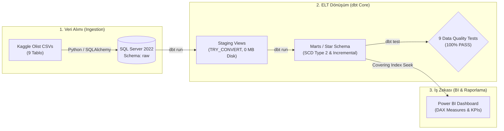
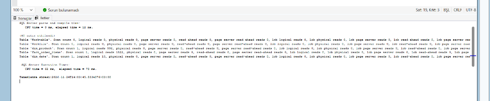
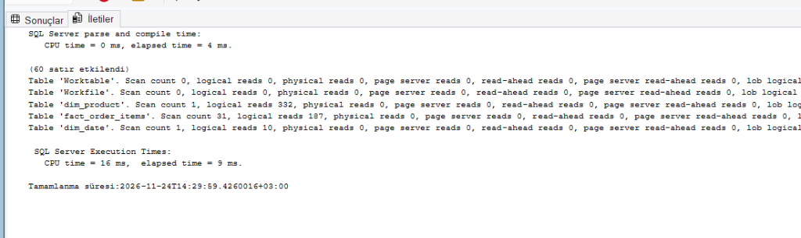
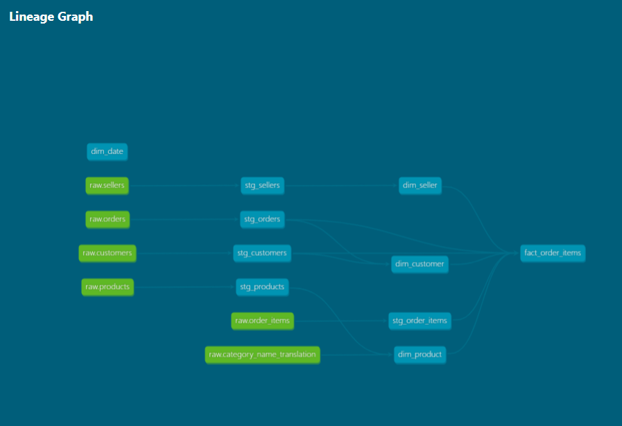
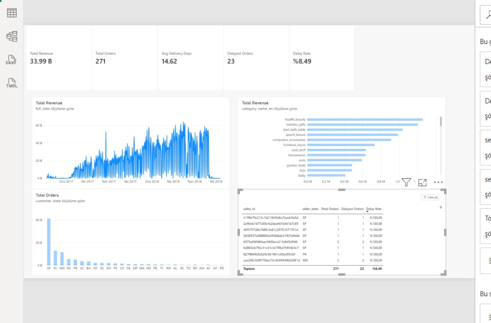

# 🛒 Olist E-Commerce Data Warehouse & Analytics Platform

[](https://www.microsoft.com/sql-server)
[](https://www.getdbt.com)
[](https://www.python.org)
[](https://powerbi.microsoft.com)
[](https://www.docker.com)

Brezilya'nın lider e-ticaret pazaryeri **Olist**'in ~100.000 sipariş ve 112.650 sipariş kalemi içeren gerçek hayat veri seti üzerine kurulmuş **uçtan uca kurumsal veri ambarı (Data Warehouse)** projesidir.

Ham CSV verilerinden başlayarak **Kimball Boyutsal Modelleme (Star Schema)**, **SCD Type 2 (Yavaş Değişen Boyutlar)**, **dbt (Data Build Tool)** ile modern ELT katmanı, **SQL Server indeksleme ve sorgu optimizasyonu (%88 I/O tasarrufu)**, **Power BI iş zekası panosu** ve tek tıkla ayağa kalkan **Docker** altyapısını içerir.

---

## 🏗️ 1. Mimari (Architecture)

Proje, modern **ELT (Extract - Load - Transform)** mimarisini benimser:



---

## 📐 2. Veri Modelleme (Kimball Star Schema)

- **Grain (Tane):** Bir sipariş kalemi (`order_id`, `order_item_id`).
- **Olgu Tablosu (Fact):** `dw.fact_order_items` (112.650 satır; Fiyat, navlun bedeli, teslimat süresi, gecikme farkı).
- **Boyut Tabloları (Dimensions):**
  - `dw.dim_product`: Kategori çevirileri ile zenginleştirilmiş ürün bilgisi (32.951 tekil ürün).
  - `dw.dim_seller`: Satıcı konumu ve eyalet bilgisi (3.095 satıcı).
  - `dw.dim_date`: 2016-2018 yıllarını kapsayan, tamsayı anahtarlı (`YYYYMMDD`) tarih boyutu (Tally CTE ile üretildi).
  - `dw.dim_customer` (**SCD Type 2**): Müşterilerin taşınma ve adres değişiklik geçmişini korumak için `valid_from`, `valid_to` ve `is_current` alanlarıyla tasarlanmış yavaş değişen boyut tablosu.

---

## ⚡ 3. Sorgu Performansı ve İndeksleme (%88 Okuma Tasarrufu)

Fact tablosunda 112.650 satır üzerinde tarih ve kategori bazlı analitik bir sorgu (`SET STATISTICS IO, TIME ON`) ile kıyaslanmıştır:

| Metrik | İndeks Öncesi (Table Scan) | İndeks Sonrası (Covering Index Seek) | Kazanım |
| :--- | :--- | :--- | :--- |
| **Mantıksal Okuma (Logical Reads)** | 1.522 sayfa (~12 MB) | **187 sayfa (~1.4 MB)** | **%88 Tasarruf** |
| **CPU Süresi (CPU Time)** | 62 ms | **16 ms** | **%74 Hızlanma** |
| **Yürütme Süresi (Elapsed Time)** | 70 ms | **9 ms** | **%87 Hızlanma** |

### Kullanılan Örtücü İndeks (Covering Index):
```sql
CREATE NONCLUSTERED INDEX ix_fact_order_items_date_perf
ON dw.fact_order_items (order_date_key)
INCLUDE (product_key, price);
```

<p align="center">
  
  
</p>

---

## 🔄 4. dbt ile Modern ELT ve Veri Kalitesi Testleri

- **Staging Katmanı:** Ham veriyi 1:1 tip dönüşümleriyle temizleyen ve diskte 0 MB ek alan kaplayan view'lar (`stg_orders`, `stg_customers`, `stg_order_items`, `stg_products`, `stg_sellers`).
- **Marts Katmanı:** Analize hazır fiziksel tablolar ve büyük veri verimliliği sağlayan **Artımlı (Incremental)** `fact_order_items` modeli (`unique_key=['order_id', 'order_item_id']`).
- **Veri Kalitesi Testleri:** 9 adet otomatik veri kalitesi testi (`not_null`, `unique`, `relationships` / referans bütünlüğü) **0.88 saniyede %100 PASS** ile doğrulanmıştır.

### dbt Lineage Graph (Soy Ağacı)


---

## 📊 5. Power BI Dashboard ve İş Sorularına Cevaplar

SQL Server `dw` şemasına bağlanılarak yıldız şema ilişkileri doğrulanmış ve 5 temel analitik soru görselleştirilmiştir:



### Temel İş Çıkarımları:
1. **Toplam Hacim & Ciro:** 99.4K tekil sipariş üzerinden **13.59M R$** toplam ciro elde edilmiştir.
2. **Sezonsallık:** Kasım 2017 Black Friday döneminde platform tarihinin en yüksek günlük ve aylık ciro pikine ulaşılmıştır.
3. **Top Kategoriler:** En yüksek geliri getiren sektörler **Health & Beauty (1.25M R$)**, **Watches & Gifts (1.20M R$)** ve **Bed Bath Table (1.03M R$)** olmuştur.
4. **Coğrafi Hakimiyet:** Sao Paulo (`SP`) eyaleti, siparişlerin ve cironun **%40'ından fazlasını** tek başına üretmektedir.
5. **Lojistik & Gecikme:** Brezilya genelinde ortalama teslimat süresi **12.41 gün** olup siparişlerin **%6.62**'si vaat edilen süreden geç teslim edilmiştir.

---

## 🚀 6. Projeyi Çalıştırma (Quickstart with Docker)

Projeyi herhangi bir bilgisayarda (Windows, Mac, Linux) sıfırdan tek komutla ayağa kaldırmak için:

```bash
# 1. Depoyu klonlayın
git clone https://github.com/HelenAktas7/olist-data-warehouse.git
cd olist-data-warehouse

# 2. SQL Server 2022 konteynerini başlatın
docker compose up -d

# 3. Sanal ortamı kurun ve bağımlılıkları yükleyin
python -m venv .venv
# Windows için:
.\.venv\Scripts\Activate
# Mac/Linux için:
# source .venv/bin/activate

pip install -r requirements.txt

# 4. Veritabanını oluşturun ve ham CSV verilerini yükleyin
python load_raw.py

# 5. dbt dönüşümlerini ve testlerini koşturun
dbt run --target docker
dbt test --target docker
```

---

## 📂 Proje Dizin Yapısı

```text
olist-data-warehouse/
├── data/raw/              # Olist Kaggle ham CSV veri dosyaları
├── docs/images/           # Dashboard, Lineage ve İndeksleme görselleri
├── models/                # dbt modelleri
│   ├── staging/           # Kaynak view tanımları ve temizlik
│   └── marts/             # Dim & Fact tabloları ve test şemaları
├── sql/                   # T-SQL DDL, SCD Type 2, Indexing ve Test scriptleri
├── docker-compose.yml     # SQL Server 2022 konteyner tanımı
├── dbt_project.yml        # dbt konfigürasyonu
├── load_raw.py            # Otomatik veritabanı oluşturan ve veri yükleyen Python scripti
├── olist_dashboard.pbix   # Power BI analitik pano dosyası
└── requirements.txt       # Python ve dbt bağımlılıkları
```
